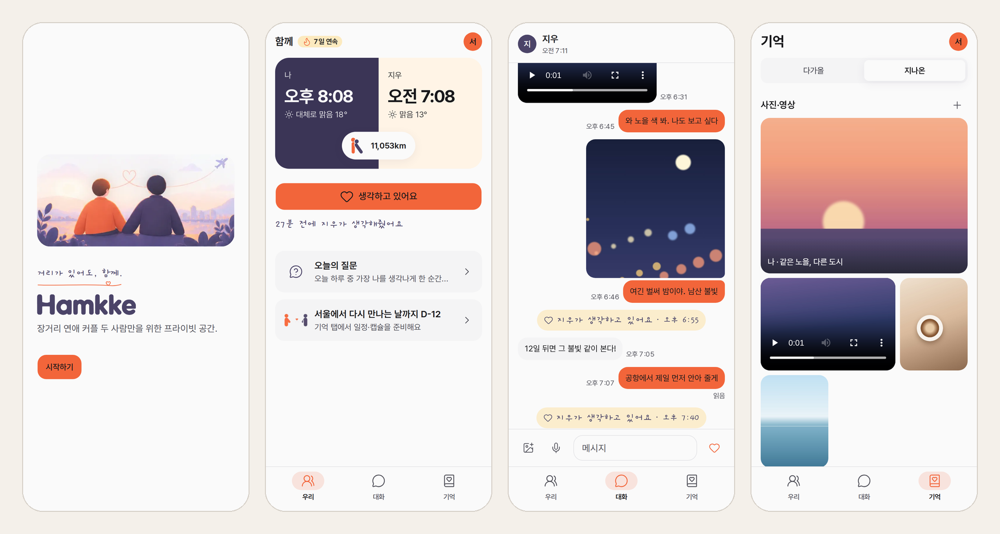
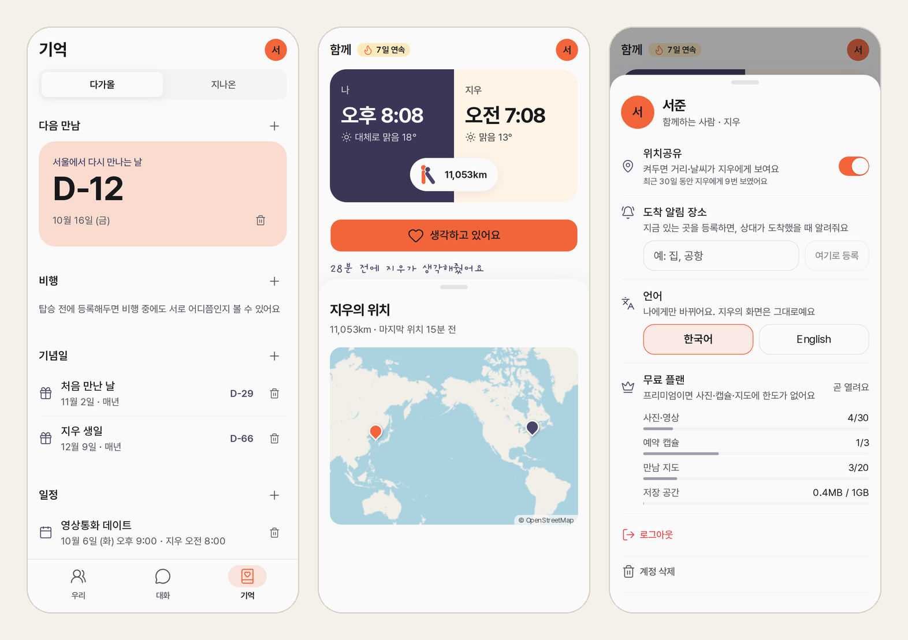
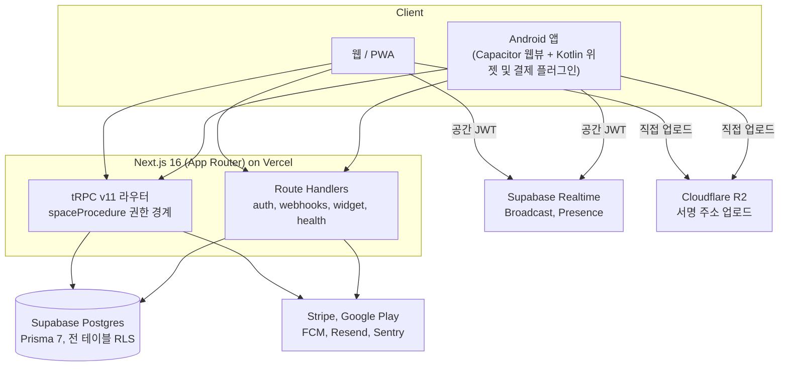
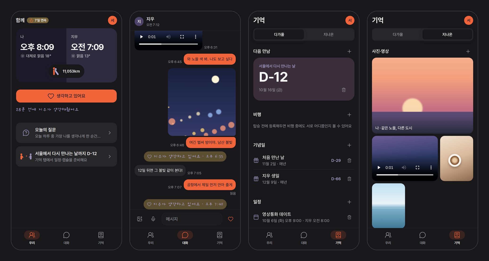

<p align="center">
  <picture>
    <source media="(prefers-color-scheme: dark)" srcset="assets/brand/logo-ko-dark.svg">
    
  </picture>
</p>

<p align="center">장거리 연애 커플을 위한 2인 전용 프라이빗 웹 및 Android 앱 (배포 전 지속 개발 중)</p>

<p align="center">
  Next.js 16 | TypeScript | tRPC | Prisma | Postgres(Supabase) | Capacitor | Stripe
</p>

<p align="center"></p>

## 한눈에 보기

시차와 물리적 거리를 두고 생활하는 2인 커플을 위한 프라이빗 웹 및 Android 애플리케이션입니다. 서로의 현지 시각, 날씨, 수면 추정, 비행 상태, 대화, 일정, 위치 공유를 하나의 공유 공간(Space)에서 관리합니다.

- **초대코드 기반 2인 전용 공간**: 초대코드로 연결된 두 사람만 사용하며, 공개 가입, 검색, 친구 추천 기능이 없습니다.
- **단일 코드베이스 및 단일 목적 화면**: 하단 탭 세 개(우리, 대화, 기억)와 시트로 화면을 구성하고, 웹과 Android 앱이 동일한 Next.js 코드베이스를 공유합니다.
- **출시 기준 컴플라이언스**: 위치정보법 동의와 제공 사실 기록, 개인정보처리방침과 약관, 회원 탈퇴, Google Play 한국 대체 결제, 무중단 배포 파이프라인을 포함합니다.

## 주요 기능

| 화면     | 하는 일                                                                                                                                |
| -------- | -------------------------------------------------------------------------------------------------------------------------------------- |
| **우리** | 두 사람의 지금을 한 장면으로 보여 줍니다. 서로의 현지 시각, 시간대에 따라 바뀌는 하늘, 날씨, 수면 추정("자고 있을 시간"), 둘 사이 거리 |
| **대화** | 텍스트, 사진, 영상, 음성 메시지. 읽음 표시와 입력 중 표시가 있고, 터치가 대화 흐름 사이에 끼어듭니다                                   |
| **기억** | 다가올 일(만남, 비행, 기념일, 공유 캘린더, 타임캡슐)과 지나온 일(사진, 영상, 만남 지도, 열린 캡슐, 지난 질문과 답)                      |
| **시트** | 위치(지도, 옵트인 위치 공유, 도착하면 알려 주는 장소)와 설정(언어, 요금제와 사용량, 정책 문서, 탈퇴)                                   |

- **생각하고 있어요**: 우리 탭의 주인공인 버튼 하나. 누르면 상대에게 터치가 가고, 받은 터치는 손글씨로 남습니다.
- **상황 카드**: 오늘의 질문, D-day, 기념일, 도착한 캡슐, 비행 중 같은 상황을 우선순위대로 최대 두 장만 보여 줍니다. 만남이 가까워지면 장면 자체가 바뀝니다.
- **비행 모드**: 탑승권 바코드를 스캔해 등록하면, 그 사람 쪽이 "하늘 위"로 바뀌어 진행률과 남은 시간을 보여 줍니다.
- **Android 홈 화면 위젯**: 상대의 지금 시각, 시차, 거리, 마지막 터치.
- **푸시 알림**은 받는 사람의 언어로, **한국어와 영어**는 각자 고르고, **다크 모드**는 시스템을 따릅니다.

<p align="center"></p>

## 핵심 설계

### 1. tRPC spaceProcedure 권한 경계와 전 테이블 RLS

모든 공간 데이터의 접근 제어는 요청자가 해당 공간(Space)의 멤버인지 검증하는 단일 규칙에 따릅니다. 페어링과 헬스 체크를 제외한 모든 기능 라우터는 tRPC 미들웨어 `spaceProcedure` 위에서 동작해 라우터별 권한 확인 누락을 막습니다([`src/server/trpc/init.ts`](src/server/trpc/init.ts)).

앱 서버는 Prisma로만 DB에 접근하지만, Supabase가 `public` 스키마를 Data API로 노출할 수 있으므로 모든 테이블에 RLS를 활성화하고, RLS가 비활성화된 테이블이 있으면 실패하는 테스트([`db-security.test.ts`](src/server/db-security.test.ts))로 누락을 방지합니다. 실시간 채널 역시 서버가 공간 ID 클레임을 담아 서명한 ES256 JWT를 사용하고, Supabase Realtime RLS가 채널 이름과 클레임을 대조해 타인의 구독을 차단합니다([`realtime-token.ts`](src/server/realtime-token.ts)).

### 2. IANA 시간대 오프셋과 탑승권(BCBP) 기반 비행 추정

- **시차 계산**: 서머타임 변동 때문에 두 IANA 시간대의 오프셋을 매 시점 기준으로 계산합니다. 잘못된 시간대 문자열이 `RangeError`를 일으켜 상대방 렌더링까지 중단시키지 않도록 저장과 출력 양쪽에서 검증합니다([`timezone.ts`](src/lib/timezone.ts)).
- **하늘 색상**: 각자의 현지 시각을 기준으로 계산하며, 비행 중인 경우 추정 위치의 경도를 이용해 태양시(UTC + 경도/15)를 산출합니다([`sky.ts`](src/lib/sky.ts)).
- **비행 진행 추정**: 유료 항공편 API 없이 예정 시각과 대권 경로로 진행률을 계산합니다. 탑승권 바코드(IATA BCBP) 파서는 편명, 공항, 날짜만 추출하고 이름, 예약번호, 좌석 정보는 파기합니다([`flight.ts`](src/lib/flight.ts), [`bcbp.ts`](src/lib/bcbp.ts)).

시간, 거리, 비행 계산은 모두 `src/lib/`의 순수 함수로 분리해 서버와 클라이언트가 공유하고 단위 테스트로 경계 시각을 검증합니다.

### 3. 위치정보법 제공 기록과 서명 URL 미디어 보호

위치정보법 요건을 기능 요구사항으로 반영했습니다([`location-provision.ts`](src/server/location-provision.ts)).

- **동의 기반 수집**: 위치기반서비스 약관에 동의해야 위치 공유가 켜지며, 앱이 열려 있을 때만 위치를 전송합니다(백그라운드 추적 없음).
- **제공 사실 기록**: 상대에게 위치나 위치 기반 정보(거리, 위젯 표시 포함)가 전달될 때마다 제공 사실을 자동 기록합니다. 동일 시간대 기록은 `ON CONFLICT`로 한 행에 병합해 동시 요청 시 행 증가를 막고, 보관 기간(6개월 이상)이 지난 기록은 쓰기 시점에 정리하며 30일 주기로 모아서 알립니다.
- **철회 및 탈퇴**: 공유를 끄면 동의가 철회되고 위치와 기록이 삭제되며, 한 명이 탈퇴하면 공유 공간 전체를 삭제합니다.
- **미디어 및 오류 스크러빙**: 사진, 영상, 음성은 영구 공개 URL 없이 짧은 유효기간의 서명 URL로만 조회합니다. Sentry 오류 이벤트는 이메일, 메시지 본문, 좌표, 토큰을 키 이름 단위로 제거한 뒤 전송합니다([`sentry-scrub.ts`](src/lib/sentry-scrub.ts)).

### 4. 공간 단위 Stripe 구독과 Google Play 한국 대체 결제

구독 플랜은 개인이 아닌 **공간 단위**로 적용되어 한 명이 구독하면 두 명 모두 혜택을 받습니다.

|           | 무료 | 프리미엄  |
| --------- | ---- | --------- |
| 사진, 영상 | 30개 | 제한 없음 |
| 예약 캡슐 | 3개  | 제한 없음 |
| 만남 지도 | 20곳 | 제한 없음 |
| 저장 공간 | 1GB  | 20GB      |

웹은 Stripe(Checkout, Customer Portal, Webhook)로 결제하며, Android 앱은 Google Play 한국 대체 결제를 사용합니다. Kotlin 로컬 플러그인이 Play Billing Library로 안내와 거래 토큰을 처리한 뒤 Stripe 결제로 연결하고, 서버가 결제, 갱신, 환불 내역을 Play 개발자 API에 보고합니다. 대체 결제를 지원하지 않는 기기에서는 결제 진입을 숨깁니다. 저장 용량 한도는 업로드 URL 발급 시점(신고 크기)과 등록 시점(실제 크기)에 이중 검증합니다([`storage-quota.ts`](src/server/storage-quota.ts)).

> 결제 기능은 구현되어 있으며, 현재 환경 변수(`PREMIUM_OPEN`)로 유료 플랜 노출을 비활성화한 상태입니다.

### 5. 한영 개별 언어 설정과 한국어 조사 처리

한국어와 영어를 두 사용자가 각자 독립적으로 선택할 수 있으며, 푸시 알림도 수신자의 언어 설정에 맞춰 발송합니다.

- **동적 한국어 조사**: 상대 이름은 사용자가 직접 입력하므로 받침 유무에 따라 조사를 동적으로 선택하고, 숫자로 끝나는 편명("KE081이")은 한국어 발음 기준으로 판별합니다([`josa.ts`](src/lib/josa.ts)).
- **번역 누락 검증**: pseudo-locale 모드를 두고 E2E 테스트에서 영어 및 pseudo-locale 화면에 한국어가 0자인지 검사해 하드코딩된 문구를 차단합니다.

### 6. 스키마 하위 호환 마이그레이션과 스모크 테스트 후 도메인 전환

`main` 브랜치 push 시 CI가 린트, 타입 검사, Prettier, Vitest(Postgres 서비스 컨테이너), 빌드, Playwright E2E를 통과한 뒤 아래 순서로 배포합니다.


- 빌드가 실패하면 운영 DB 마이그레이션 전에 중단하며, 스모크 테스트(`/api/health` DB 연결, 로그인, 정책 페이지)가 실패하면 도메인을 이전 배포에 유지합니다.
- 마이그레이션이 먼저 적용되므로 이전 배포 코드도 새 스키마에서 동작하도록 열 삭제나 이름 변경은 두 번의 배포로 나누어 진행합니다.

## 구조



| 영역       | 쓰는 것                                                             |
| ---------- | ------------------------------------------------------------------- |
| 프레임워크 | Next.js 16(App Router), React 19, TypeScript                        |
| API        | tRPC v11 + TanStack Query, Zod                                      |
| DB         | Postgres(Supabase) + Prisma 7, 모델 22개, 마이그레이션 32개         |
| 인증       | Auth.js(Google, 이메일 매직링크)                                    |
| 실시간     | Supabase Realtime(Broadcast + Presence, private 채널)               |
| 미디어     | Cloudflare R2(사진 10MB, 영상 100MB, 음성 5MB)                      |
| 푸시       | Firebase Cloud Messaging(웹, Android)                               |
| 결제       | Stripe, Google Play 한국 대체 결제(Play Billing Library 9.1)        |
| UI         | Tailwind CSS v4, shadcn/ui(Radix), Vaul, Sonner, Motion             |
| 지도, 날씨 | react-leaflet + OpenStreetMap, Open-Meteo                           |
| 언어       | next-intl(`messages/ko.json`, `en.json`)                            |
| 모바일     | Capacitor(Android), 홈 화면 위젯은 Jetpack Glance                   |
| 품질       | Vitest(단위, 통합, 실제 DB), Playwright(e2e), GitHub Actions, Sentry |

```
src/app/         라우트: login, onboarding, home(우리, 대화, 기억 + 시트), legal, account, api
src/server/      tRPC 라우터와 서버 전용 로직(권한, 요청 제한, 계정 삭제, 위치 제공 기록, Play 보고)
src/lib/         순수 로직(시간, 거리, 요금제, 상황 카드, 비행, 조사)과 외부 서비스 클라이언트
src/legal/       개인정보처리방침, 이용약관, 위치기반서비스 약관
prisma/          스키마와 마이그레이션
android/         Capacitor 셸, 홈 화면 위젯 및 대체 결제 플러그인(Kotlin)
e2e/             Playwright 핵심 흐름(페어링, 채팅, 위치 공유, 구독), 언어 검사
```

<p align="center"></p>

## 로컬에서 실행하기

Node `24.21.0`, Docker(Postgres 16)가 필요합니다.

```bash
npm ci
cp .env.example .env          # 키마다 발급 방법이 주석으로 적혀 있습니다
docker compose up -d          # 로컬 Postgres
npx prisma migrate deploy && npx prisma generate
npm run dev                   # http://localhost:3000
npm run dev:seed-couple       # 페어링된 테스트 커플 만들기(출력된 세션 토큰을 쿠키 authjs.session-token에)
```

지금은 `.env.example`의 키가 있으면 외부 연동까지 실제 테스트 모드로 돌고, Stripe 키가 없어도 `npm run verify`와 `npm run test:e2e`는 내장 시뮬레이터(`scripts/stripe-sim.mjs`)를 자동으로 띄워 구독 시나리오까지 건너뛰지 않고 검증합니다.

| 명령                                          | 하는 일                                                            |
| --------------------------------------------- | ------------------------------------------------------------------ |
| `npm run verify:fast`                         | 빠른 전체 검사(린트, 타입, 포맷, 마이그레이션, 단위, 정적 규칙 검사) |
| `npm run verify`                              | `verify:fast` + Playwright e2e(포트 점유 확인, Stripe 시뮬레이터)  |
| `npm test`                                    | Vitest(통합 테스트는 로컬 DB에 쓰고 지웁니다)                      |
| `npm run test:e2e`                            | Playwright(로컬 DB에서만 실행됩니다)                               |
| `npm run lint`, `typecheck`, `format:check` | ESLint, 타입 검사, Prettier                                      |
| `cd android && ./gradlew assembleDebug`       | Android 디버그 APK(먼저 `npx cap sync android`)                    |
