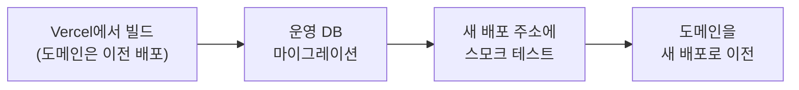
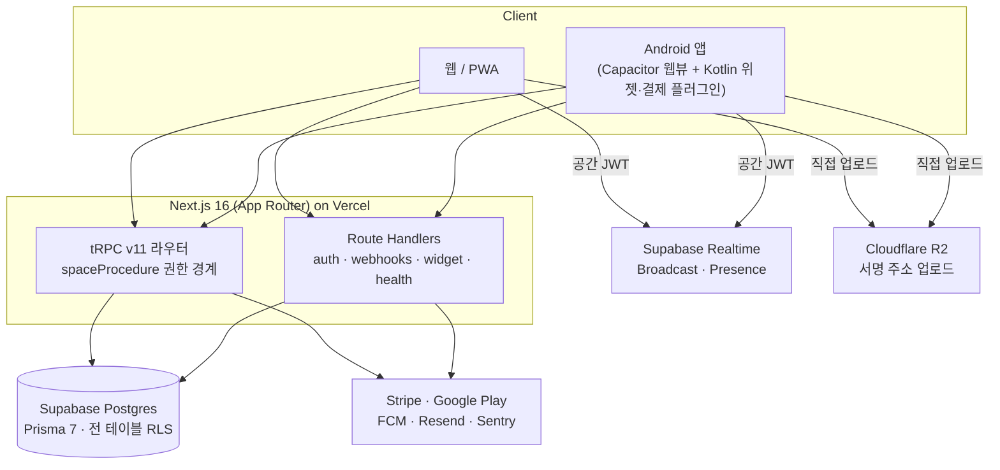

<p align="center">
  <picture>
    <source media="(prefers-color-scheme: dark)" srcset="assets/brand/logo-ko-dark.svg">
    
  </picture>
</p>

<p align="center"><b>떨어져 있는 두 사람이 서로의 하루에 기대어 지내는 곳.</b><br>장거리 연애 커플을 위한 2인 전용 프라이빗 앱(웹 · Android)</p>

<p align="center">
  Next.js 16 · TypeScript · tRPC · Prisma · Postgres(Supabase) · Capacitor · Stripe<br>
  2026.08 – 2026.10 · 커밋 317개 · 테스트 약 320개
</p>

<p align="center"></p>

## 한눈에 보기

흔한 커플 앱은 기념일과 사진첩이 중심입니다. 장거리 커플에게 더 자주 필요한 건 다른 질문입니다. **지금 저쪽은 몇 시지? 자고 있을까? 다음엔 언제 만나지?** 함께는 이 **시차와 거리**를 중심에 두고 설계했습니다.

- 초대코드로 연결된 두 사람만 씁니다. 오픈 가입, 검색, 친구 추천이 없습니다.
- 화면은 하단 탭 세 개(**우리 · 대화 · 기억**)와 그 위에 열리는 시트가 전부입니다. 화면마다 초점은 하나입니다.
- 웹과 Android 앱이 코드베이스 하나를 씁니다. 별도의 백엔드 서버는 없습니다.
- 출시를 전제로 만들었습니다. 위치정보법 동의와 기록, 개인정보처리방침과 약관, 탈퇴, Google Play 한국 대체 결제, 무중단 배포 파이프라인까지 포함합니다.

## 주요 기능

| 화면     | 하는 일                                                                                                                                |
| -------- | -------------------------------------------------------------------------------------------------------------------------------------- |
| **우리** | 두 사람의 지금을 한 장면으로 보여 줍니다. 서로의 현지 시각, 시간대에 따라 바뀌는 하늘, 날씨, 수면 추정("자고 있을 시간"), 둘 사이 거리 |
| **대화** | 텍스트, 사진, 영상, 음성 메시지. 읽음 표시와 입력 중 표시가 있고, 터치가 대화 흐름 사이에 끼어듭니다                                   |
| **기억** | 다가올 일(만남, 비행, 기념일, 공유 캘린더, 타임캡슐)과 지나온 일(사진·영상, 만남 지도, 열린 캡슐, 지난 질문과 답)                      |
| **시트** | 위치(지도, 옵트인 위치 공유, 도착하면 알려 주는 장소)와 설정(언어, 요금제와 사용량, 정책 문서, 탈퇴)                                   |

- **생각하고 있어요**: 우리 탭의 주인공인 버튼 하나. 누르면 상대에게 터치가 가고, 받은 터치는 손글씨로 남습니다.
- **상황 카드**: 오늘의 질문, D-day, 기념일, 도착한 캡슐, 비행 중 같은 상황을 우선순위대로 최대 두 장만 보여 줍니다. 만남이 가까워지면 장면 자체가 바뀝니다.
- **비행 모드**: 탑승권 바코드를 스캔해 등록하면, 그 사람 쪽이 "하늘 위"로 바뀌어 진행률과 남은 시간을 보여 줍니다.
- **Android 홈 화면 위젯**: 상대의 지금 시각, 시차, 거리, 마지막 터치.
- **푸시 알림**은 받는 사람의 언어로, **한국어·영어**는 각자 고르고, **다크 모드**는 시스템을 따릅니다.

<p align="center"></p>

## 기술적으로 고민한 것

### 1. 두 사람만 보는 데이터: 권한 경계를 한 곳으로

이 앱의 권한 모델은 "요청자가 이 공간(Space)의 멤버인가" 하나입니다. 이 질문을 라우터마다 흩어 두지 않고 tRPC 미들웨어 `spaceProcedure` 한 곳에서만 확인합니다. 페어링·헬스 체크처럼 공간이 생기기 전에 쓰는 것을 빼면 채팅, 위치, 기억 같은 기능 라우터는 모두 이 프로시저 위에서 동작합니다. 그래서 새 기능을 추가해도 권한 확인을 빠뜨리기 어렵습니다([`src/server/trpc/init.ts`](src/server/trpc/init.ts)).

DB 쪽에는 방어선을 하나 더 두었습니다. 앱은 Prisma로만 DB에 접근하지만, Supabase는 `public` 스키마를 Data API로 노출할 수 있습니다. 그래서 모든 테이블에 RLS를 켜 두고, **RLS가 꺼진 테이블이 하나라도 생기면 실패하는 테스트**로 이를 지킵니다([`db-security.test.ts`](src/server/db-security.test.ts)).

실시간 채널도 같은 원칙을 따릅니다. 서버가 공간 ID를 클레임에 담은 ES256 JWT를 직접 서명하고, Supabase Realtime이 RLS로 채널 이름과 클레임을 대조합니다. 다른 커플의 채널은 구독 단계에서 막힙니다([`realtime-token.ts`](src/server/realtime-token.ts)).

### 2. 시간은 상수가 아니다: 시차·하늘·비행

- **시차**는 서머타임 때문에 고정값이 아닙니다. 두 IANA 시간대의 오프셋을 매번 현재 시점 기준으로 계산합니다. 잘못된 시간대 문자열 하나가 `RangeError`로 **상대의** 화면 렌더링까지 멈추는 문제가 있어, 저장과 출력 양쪽에서 검증합니다([`timezone.ts`](src/lib/timezone.ts)).
- **하늘 색**은 각자의 현지 시각으로 정합니다. 비행 중인 사람은 시간대가 없는 하늘 위에 있으므로, 추정 위치의 경도로 태양시(UTC + 경도/15)를 계산해 씁니다([`sky.ts`](src/lib/sky.ts)).
- **비행 진행**은 유료 항공편 API 없이 예정 시각과 대권 경로만으로 계산합니다. 모든 판단을 "가장 믿을 만한 시각" 하나에서 끌어내도록 설계해, 나중에 실제 시각이 들어오면 화면이 코드 수정 없이 정확해집니다. 탑승권 바코드(IATA BCBP)는 직접 파싱하되 편명·공항·날짜만 읽고 이름·예약번호·좌석은 버립니다([`flight.ts`](src/lib/flight.ts), [`bcbp.ts`](src/lib/bcbp.ts)).

이런 계산은 모두 `src/lib/`의 순수 함수로 분리해 서버와 클라이언트가 같이 쓰고, 단위 테스트로 경계 시각을 고정해 둡니다.

### 3. 위치정보는 법이 정한 대로

한국에서 위치를 다루는 서비스는 위치정보법을 지켜야 합니다. 이를 기능 요구사항으로 받아 구현했습니다([`location-provision.ts`](src/server/location-provision.ts)).

- 위치 공유는 위치기반서비스 약관에 동의해야 켜지고, 앱이 열려 있을 때만 위치를 보냅니다(백그라운드 추적 없음).
- 상대에게 위치나 위치에서 나온 정보(거리, 위젯 표시 포함)가 갈 때마다 **제공 사실을 자동 기록**합니다. 같은 시간대의 기록은 `ON CONFLICT`로 한 행에 모아 동시 요청에도 행이 불어나지 않게 했습니다.
- 기록은 6개월 이상 보관하고 30일마다 모아서 알립니다. 보관 기간이 지난 기록은 별도 스케줄러 없이 쓰기 시점에 정리합니다.
- 공유를 끄면 동의가 철회되고 위치와 기록이 지워집니다. 한 사람이 탈퇴하면 둘이 함께 만든 공간이 통째로 지워집니다.

개인정보도 같은 기준으로 다룹니다. 사진·영상·음성에는 영구 공개 주소가 없고 볼 때마다 짧게 유효한 서명 주소를 발급합니다. Sentry로 나가는 오류 이벤트에서는 이메일, 메시지 본문, 좌표, 토큰을 키 이름 단위로 걸러 냅니다([`sentry-scrub.ts`](src/lib/sentry-scrub.ts)).

### 4. 결제: 공간 단위 구독과 Play 한국 대체 결제

요금제는 사람이 아니라 **공간 단위**입니다. 한 사람이 구독하면 둘 다 혜택을 받습니다.

|           | 무료 | 프리미엄  |
| --------- | ---- | --------- |
| 사진·영상 | 30개 | 제한 없음 |
| 예약 캡슐 | 3개  | 제한 없음 |
| 만남 지도 | 20곳 | 제한 없음 |
| 저장 공간 | 1GB  | 20GB      |

웹은 Stripe(Checkout · Customer Portal · Webhook)로 결제합니다. Android 앱은 Google Play **한국 대체 결제**를 씁니다. Kotlin 로컬 플러그인이 Play Billing Library로 대체 결제 안내를 띄우고 거래 토큰을 받으면, 같은 Stripe 결제로 넘어갑니다. 서버는 결제·갱신·환불을 Play 개발자 API에 보고합니다. 대체 결제를 쓸 수 없는 기기에서는 결제 진입 자체를 숨깁니다. 앱 밖 결제로 안내하면 정책 위반이기 때문입니다.

용량 한도는 업로드 주소를 발급할 때(신고한 크기)와 등록할 때(실제 크기) 두 번 검사합니다. 클라이언트가 크기를 속여도 한도를 넘을 수 없습니다([`storage-quota.ts`](src/server/storage-quota.ts)).

> 결제 기능은 모두 구현했지만, 지금은 환경 변수(`PREMIUM_OPEN`)로 유료 플랜을 닫아 두었습니다.

### 5. 두 언어를 각자의 언어로

한국어와 영어는 두 사람이 각자 고릅니다. 푸시 알림도 받는 사람의 언어로 보냅니다. 영어 문구는 번역하지 않고 영어로 새로 썼습니다.

- 상대 이름은 사용자가 정하므로, 고정 조사를 붙이면 절반은 틀립니다("민준이가"). 받침 유무로 조사를 고르고, 숫자로 끝나는 편명("KE081이")은 한국어 읽기로 판단합니다([`josa.ts`](src/lib/josa.ts)).
- 가짜 언어(pseudo-locale) 모드를 두고, e2e에서 **영어·가짜 언어 화면에 한국어가 0자**인지 검사해 하드코딩된 문구를 잡습니다.

### 6. 배포: 마이그레이션이 먼저, 도메인은 마지막에

`main`에 push하면 CI가 린트, 타입 검사, Prettier, Vitest(실제 Postgres 서비스 컨테이너), 빌드, Playwright e2e를 거쳐 배포합니다. 배포 순서는 실패해도 사용자가 깨진 화면을 보지 않도록 짰습니다.



- 빌드가 깨지면 운영 DB를 건드리기 전에 멈춥니다.
- 스모크 테스트(`/api/health`의 DB 연결, 로그인, 정책 페이지)가 실패하면 도메인은 이전 배포에 그대로 남습니다.
- 마이그레이션은 이미 적용된 뒤일 수 있으므로, 이전 코드도 새 스키마에서 돌아야 합니다. 열을 지우거나 이름을 바꾸는 변경은 두 번의 배포로 나눕니다.

## 구조



| 영역       | 쓰는 것                                                             |
| ---------- | ------------------------------------------------------------------- |
| 프레임워크 | Next.js 16(App Router), React 19, TypeScript                        |
| API        | tRPC v11 + TanStack Query, Zod                                      |
| DB         | Postgres(Supabase) + Prisma 7, 모델 22개, 마이그레이션 33개         |
| 인증       | Auth.js(Google, 이메일 매직링크)                                    |
| 실시간     | Supabase Realtime(Broadcast + Presence, private 채널)               |
| 미디어     | Cloudflare R2(사진 10MB, 영상 100MB, 음성 5MB)                      |
| 푸시       | Firebase Cloud Messaging(웹, Android)                               |
| 결제       | Stripe, Google Play 한국 대체 결제(Play Billing Library 9.1)        |
| UI         | Tailwind CSS v4, shadcn/ui(Radix), Vaul, Sonner, Motion             |
| 지도·날씨  | react-leaflet + OpenStreetMap, Open-Meteo                           |
| 언어       | next-intl(`messages/ko.json`, `en.json`)                            |
| 모바일     | Capacitor(Android), 홈 화면 위젯은 Jetpack Glance                   |
| 품질       | Vitest(단위·통합, 실제 DB), Playwright(e2e), GitHub Actions, Sentry |

```
src/app/         라우트: login, onboarding, home(우리·대화·기억 + 시트), legal, account, api
src/server/      tRPC 라우터와 서버 전용 로직(권한, 요청 제한, 계정 삭제, 위치 제공 기록, Play 보고)
src/lib/         순수 로직(시간·거리·요금제·상황 카드·비행·조사)과 외부 서비스 클라이언트
src/legal/       개인정보처리방침·이용약관·위치기반서비스 약관
prisma/          스키마와 마이그레이션
android/         Capacitor 셸, 홈 화면 위젯·대체 결제 플러그인(Kotlin)
e2e/             Playwright 핵심 흐름(페어링 → 채팅 → 위치 공유 → 구독), 언어 검사
```

<p align="center"></p>

## 로컬에서 실행하기

Node `24.21.0`, Docker(Postgres 16)가 필요합니다.

```bash
npm ci
cp .env.example .env          # 키마다 발급 방법이 주석으로 적혀 있습니다
docker compose up -d          # 로컬 Postgres
npx prisma migrate deploy && npx prisma generate
npm run dev                   # http://localhost:3000
npm run dev:seed-couple       # 페어링된 테스트 커플 만들기(출력된 세션 토큰을 쿠키 authjs.session-token에)
```

지금은 `.env.example`의 키가 모두 있어야 앱 전체가 정상으로 뜹니다. 각 서비스의 무료·테스트 모드 키로 충분합니다.

| 명령                                          | 하는 일                                         |
| --------------------------------------------- | ----------------------------------------------- |
| `npm test`                                    | Vitest(통합 테스트는 로컬 DB에 쓰고 지웁니다)   |
| `npm run test:e2e`                            | Playwright(로컬 DB에서만 실행됩니다)            |
| `npm run lint` · `typecheck` · `format:check` | ESLint · 타입 검사 · Prettier                   |
| `cd android && ./gradlew assembleDebug`       | Android 디버그 APK(먼저 `npx cap sync android`) |
